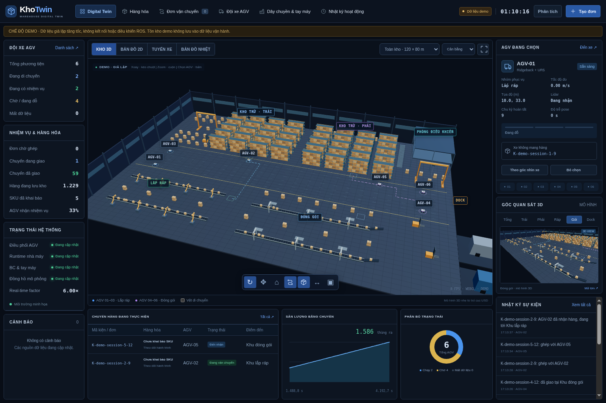
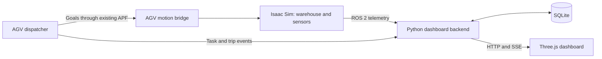

# Warehouse Twin · KhoTwin

**Warehouse simulation, fleet telemetry and a 3D operations dashboard.**

Built around **Isaac Sim 6.1 · ROS 2 Humble · Python · Three.js · SQLite**.



*Dashboard screenshot uses demo data, not live operational measurements.*

KhoTwin connects a simulated warehouse to a local dashboard for observing AGVs, production telemetry and inventory transfers. The scene spans **120 × 80 m**, with **6 Ridgeback + UR5 AGVs**, **40 racks**, **4 conveyors** and **8 Comau N220 arms**.

## Try the dashboard

No Isaac, ROS, GPU, npm or additional Python packages are required for the demo. Use system Python 3.10+ on Ubuntu:

```bash
bash scripts/run_web.sh --demo
```

Open **http://127.0.0.1:8080**. Demo inventory is held in a temporary database and never updates operational stock.

## Capabilities

| Area | Included |
| --- | --- |
| Digital twin | Interactive 3D, 2D map, configured routes, trails, occupancy heatmap and vehicle selection |
| Fleet | Pose, estimated speed, lidar freshness, task phase, load state and completed cycles |
| Inventory | SKU intake, location stock, reservations, minimum stock alerts and CSV export |
| Transfers | Priority queue, trip assignment, pickup/delivery accounting, event history and reconciliation |
| Production | Conveyor/carton motion, eight arm animations, output counters and telemetry charts |
| Reliability | SSE updates, stale data indicators, SQLite persistence and isolated demo mode |

See the detailed [feature inventory](docs/WEB_FEATURES.md).

## Architecture



The dashboard subscribes to ROS telemetry and manages declared inventory. It does not publish vehicle motion commands. Transfers attach to existing AGV cycles: left storage → assembly with robots 1–3, right storage → packing with robots 4–6. Each group moves one vehicle at a time.

## Run the simulation

Full simulation requires a separately installed Isaac Sim, ROS 2, downloaded assets and the external APF workspace. Start with the [setup and reproducibility guide](docs/SETUP.md); those dependencies are not included in this repository.

```bash
# Terminal 1: wait for Ready, then press Play
bash scripts/run_factory_live.sh

# Terminal 2
WAREHOUSE_FACTORY=1 bash scripts/run_warehouse_cycles.sh

# Terminal 3
bash scripts/run_web.sh
```

The factory launcher defaults to a lighter render profile. Use `--quality quality` to restore the original render quality. Speed in real time depends on the simulation's real-time factor (RTF).

## Project layout

| Path | Purpose |
| --- | --- |
| `src/` | Scene generation, ROS bridges, AGV dispatch and factory runtime |
| `web/` | Local HTTP/SSE backend, accounting model and 3D dashboard |
| `config/` | Asset sources, motion plans and lightweight web geometry |
| `scripts/` | Launch, build and validation commands |
| `tests/` | Offline models, web accounting and separate ROS/GPU checks |
| `tools/` | Geometry export and read-only ROS diagnostics |
| `docs/` | Operating guides, verification notes and diagrams |
| `maps/`, `assets/` | Generated scenes and downloads; excluded from Git |

## Validation and limitations

Lightweight checks cover factory flow and dashboard accounting/HTTP. ROS, USD, physics and GPU checks require the corresponding local dependencies. See the operating guides for the precise scope of historical verification.

- Factory pick/place uses scripted motion rather than contact-based grasping; AGV-mounted UR5 arms keep a fixed pose.
- Inventory is declared and updated from dispatcher events; USD carton meshes do not automatically become SKU stock.
- No PLC/ERP integration, barcode scanning, authentication or Internet deployment hardening is implemented.
- Full GUI + APF + dashboard endurance and collision-free fleet operation are not established by offline tests.

## Documentation

- [Setup](docs/SETUP.md) · [Local operations](docs/LOCAL_OPERATIONS.md)
- [Dashboard guide](docs/WEB_DASHBOARD.md) · [Feature list](docs/WEB_FEATURES.md)
- [Factory runtime](docs/FACTORY_LIVE.md) · [AGV cycles](docs/WAREHOUSE_CYCLES.md)
- [Warehouse models](docs/WAREHOUSE_MODELS.md)
- [Contributing](CONTRIBUTING.md) · [Third-party notices](THIRD_PARTY_NOTICES.md)

## License

An original-code license has not yet been selected. See [third-party notices](THIRD_PARTY_NOTICES.md) for bundled libraries and external model attribution.
